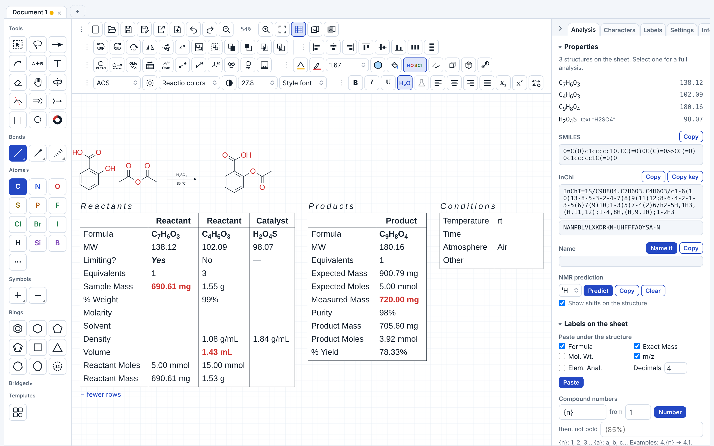

# Reactio Draw

A free chemical structure and reaction editor for organic chemists. Draw with the mouse or the keyboard, keep a
reagent table for every reaction (equivalents, masses, volumes, yield), predict NMR, and move drawings into Word
and PowerPoint or to and from other chemistry editors as CDXML and CDX files. It also helps you check HRMS data.

| [▶ Open in the browser](https://paivel.github.io/reactio-draw/web/) | [⬇ Apps for Windows, Mac and Linux](https://github.com/Paivel/reactio-draw/releases/latest) | [📖 Guide (PDF)](docs/Reactio%20Draw%20-%20Getting%20started.pdf) |
| :---: | :---: | :---: |
| nothing to install | work fully offline | every function and button explained |

https://github.com/user-attachments/assets/1637fe6d-b6d1-4ec5-9d68-9a41d62ef0c8

## What it does

| | |
| --- | --- |
| **Drawing** | drawing with the mouse as usual, with alignment guides while you drag (edges and centres snap to nearby molecules, arrows and captions); adding groups with hotkeys at the hotspot (the atom or bond under the pointer, marked green; after each key it moves on to the new group, so a chain or a substituted ring is typed key after key, and the arrow keys move it); your own labels and templates; bold or italic single characters (tBu), tBu / iPr prefixes plain, italic or italic superscript in one click; reaction and mechanism arrows, brackets and a charge corner, shapes, sandwich complexes, 3D rotation and 3D shapes, 3D styles (ball and stick, tubes, spheres, after xyzrender), orbitals; Merge structures joins structures drawn on top of each other |
| **Reactions** | a reagent table on the sheet or below it, for the selected reaction or the whole sheet: roles, limiting reagent, equivalents, masses, volumes, concentrations, yield, conditions; reagents written as text (MeMgBr, K2CO3) are counted too; multistep schemes; compound numbers that renumber themselves |
| **Analysis** | formula, molecular weight, exact mass, m/z, isotope pattern, elemental analysis, SMILES, InChI and InChIKey (offline), ¹H/¹³C/¹⁹F/³¹P NMR prediction from measured spectra; structure checks as you draw (valence, atoms on top of each other, stray bonds, wedges), each kind can be switched off |
| **Names** | common names everywhere; systematic names to structures (OPSIN) and structures to IUPAC names (openclatura) in the apps |
| **Files** | its own .reactio documents; CDXML, CDX, MOL and SDF (V2000 and V3000, 3D kept), RXN, SMILES and CXSMILES, ORD; crystal structures from CIF (a test version); pictures as SVG, PNG, EPS, TIFF; pictures on the sheet travel in CDXML and CDX; Word and PowerPoint |
| **Word and PowerPoint** | Ctrl+C → Ctrl+V into Word or PowerPoint on Windows and on Mac. **Double-click a drawing in Word to edit it, on Windows and on Mac alike**; Save in Reactio Draw puts the new drawing back in its place (Edit drawing on the Reactio Draw tab does the same). A document can travel between the two: a drawing put in on Windows is an object, one put in on a Mac a picture, so on the other system double-click does not open it — copy it instead (Ctrl+C in Word, Ctrl+V in Reactio Draw) or use Open in Reactio Draw on the tab, and it comes back complete: structures, reagent table, roles and conditions, nothing lost. The tab (Windows and Mac) also makes plain vector pictures without Reactio Draw data, puts all structures of a document into one CDXML file, and marks pictures that hold Reactio Draw data with hidden, non-printing marks |
| **Charts** | sensitivity screens — the radar diagrams of the condition-based sensitivity assessment of Glorius and co-workers ([Angew. Chem. Int. Ed. 2019, 58, 8572](https://doi.org/10.1002/anie.201901935)), editable on the sheet; product ratio pie and ring charts |
| **Working fast** | scrolling in every direction (two fingers, or Shift+wheel sideways) and zoom to the pointer; a hotkey for every button and command, all reassignable, with search by name or by key; your own templates and labels on keys |
| **API and command line** | a local API for scripts (Python, R, curl) in the desktop apps; a command line, `reactio`, that renders, converts and checks files without opening a window ([Command line.txt](Command%20line.txt)); and the same commands for web pages that embed the editor ([EMBEDDING.md](EMBEDDING.md)) |
| **Styles** | ACS, RSC, Nature, Angewandte and more, colour themes (one of them color-blind safe), dark sheets |
| **Light** | the whole editor is one web page of 4.1 MB (about 1.4 MB over the network; 6.3 MB as a single offline file with the NMR tables), with no server and nothing to install; the apps are about 20–28 MB to download. The NMR tables (2.2 MB) come only when you first predict a spectrum. For comparison, the Ketcher npm package is about 110 MB and Kekule.js about 42 MB |

## Download

| | |
| --- | --- |
| **Browser** | the link above, or `index.html` from this repository: open it in Chrome, Edge, Safari or Firefox |
| **Windows 11** | `ReactioDraw-Windows-x64.zip` (or `-ARM.zip`): unzip, run `ReactioDraw.exe` |
| **Mac** | `ReactioDraw-Mac.zip`: double-click `Install Reactio Draw.command` (builds the app on your Mac) |
| **Linux** | `ReactioDraw-Linux-x64.tar.gz` (or `-ARM`): unpack, run `./install.sh`; needs WebKitGTK |

The apps add naming (OPSIN, openclatura), Word and PowerPoint objects (Windows), the Reactio Draw tab in Word (Windows and Mac), a local API for scripts and the `reactio` command line.

**On your own site:** Reactio Draw can be embedded in any web page (an ELN, a course page, a search form) and driven from its JavaScript: see [EMBEDDING.md](EMBEDDING.md) and the working example in `examples/embed.html`.

**Tested on:** Windows 11 Enterprise 26H2, macOS Sequoia 15.7.4, Ubuntu 24.04.2 LTS. Other recent versions are likely to work but have not been checked; reports are welcome.

## Privacy

Reactio Draw makes no network requests of its own: no accounts, no tracking, no analytics, no fonts or scripts from other sites. Drawings, settings, labels and templates stay in your browser or on your computer. The only downloads are these: the web version is loaded from its site like any web page, and there the NMR tables are downloaded only when you agree, on the first Predict, and kept in the browser (clearing the site's data removes them); a link you click (GitHub, a DOI) opens in your browser. The apps download nothing.

NMR prediction is an estimate from nmrshiftdb2 data, not a measured spectrum; the copied text says where the data come from, as the nmrshiftdb2 Database License asks.

## Source

| Folder | What |
| --- | --- |
| `index.html` | the whole program in one file (drawing, analysis, NMR prediction); the apps and the download use it |
| `web/` | the web version GitHub Pages serves, made from `index.html` by `tools/make_web.py`: the NMR tables are a separate file, downloaded on the first Predict |
| `windows-app/` | Windows app: Go + WebView2 window, OLE server for Word and PowerPoint, local API |
| `macapp/` | Mac app: Swift window around the page, installers, naming helper |
| `linux-app/` | Linux app: Go window with GTK and WebKitGTK, local API |
| `data/nmr/` | how the NMR shift tables were built from nmrshiftdb2 |
| `word-addin/` | the Reactio Draw tab for Word (`Reactio Draw.dotm`) and the script and macros it is built from |
| `examples/` | `embed.html`: Reactio Draw embedded in another page (see EMBEDDING.md) |
| `docs/` | the guide `Reactio Draw - Getting started.pdf`, the hotkey chart `Reactio Draw - Hotkeys.reactio` the README picture `overview.png` and the hotkey chart as a picture |
| `tools/` | scripts that make the web version, the InChI WebAssembly build, the README picture, the hotkey chart and the Windows resources |
| `LICENSES/` | the licences of the third-party parts (see THIRD-PARTY-NOTICES.md) |

### How it was written

Reactio Draw is written from scratch for this project. No program was decompiled or disassembled, and no code from
commercial chemistry software is used. File formats are implemented from published descriptions and open-source
projects, each named in Credits and `THIRD-PARTY-NOTICES.md`:

- CDX and CDXML: the CDX property table from ReShiki, which takes it from the published CDX documentation of
  CambridgeSoft (the CDX SDK, archived by the IUPAC FAIRSpec project). Every code in it is also defined in Revvity's
  own open-source ChemDraw format library (BSD-3-Clause), the stoichiometry grid of ChemDraw (objects 0x8022–0x8024,
  properties 0x1200–0x1208) included.
- MOL, SDF and RXN: the CTfile format description.
- Word and PowerPoint objects: Microsoft's published specifications (Office Open XML / ECMA-376, compound files
  [MS-CFB], OLE objects [MS-OLEDS], RTF).
- The Reactio Draw tab in Word (`word-addin/`): a template written by `make_dotm.py` from Microsoft's published
  specifications of the VBA project [MS-OVBA] and of Office's custom tabs [MS-CUSTOMUI]; Word compiles the macros
  (`ReactioDraw.bas`) from their source.

In Word and PowerPoint the drawing is an object of its own type, `ReactioDraw.Drawing.1`; it does not pose as another
program's object.

### Building

- **Web:** nothing to build; `index.html` is the program. For a site, `python3 tools/make_web.py` writes `web/` (the page without the NMR tables, and the tables beside it).
- **Windows** (Go 1.24+): copy `index.html` into `windows-app/`, then in `windows-app/`:
  `GOOS=windows GOARCH=amd64 GOFLAGS=-mod=mod go build -trimpath -ldflags "-H windowsgui" -o ReactioDraw.exe`
  (`GOARCH=arm64 … -o ReactioDraw-ARM.exe`), and the command line: `GOOS=windows GOARCH=amd64 GOFLAGS=-mod=mod go build -trimpath -o reactio.exe ./reactio`.
  Ship `tools/`, `WebView2Loader-*.dll` and `word-addin/Reactio Draw.dotm` (the Word tab) beside the exe.
- **Linux** (Go 1.24+, no C compiler needed): `linux-app/build.sh`. Ship `tools/` (with `windows-app/tools/opsin-2.9.0.jar`)
  and the `reactio` script beside it.
- **Mac:** copy `index.html` to `macapp/index.html`, `windows-app/tools/opsin-2.9.0.jar` to `macapp/opsin.jar`
  and `word-addin/Reactio Draw.dotm` (the Word tab) into `macapp/`, then run `macapp/Install Reactio Draw.command` (needs Apple's Command Line Tools).

All libraries are in the repository (`third_party/` folders), so the builds work offline.

## How to cite

If Reactio Draw helped your work, please cite it: Sakharov, P. *Reactio Draw*, Zenodo,
[doi:10.5281/zenodo.23547490](https://doi.org/10.5281/zenodo.23547490). This DOI always leads to the latest
version; each release also has a DOI of its own (1.3: [10.5281/zenodo.23547491](https://doi.org/10.5281/zenodo.23547491)).
GitHub's **Cite this repository** button (on the right of the repository page) gives the reference in APA and
BibTeX, from `CITATION.cff`.

## Licence

Copyright © 2026 Pavel Sakharov.

Reactio Draw is free software: you can redistribute it and/or modify it under the terms of the
GNU Affero General Public License as published by the Free Software Foundation, either version 3
of the License, or (at your option) any later version. See `LICENSE`.

Anyone who distributes Reactio Draw or a modified version, or offers a modified version to others
over a network, must make its complete source code available under the same licence.
If you would like to use Reactio Draw code in a project under another licence, such as MIT, open an issue:
as the author, I can grant a separate licence.
Drawings, files and schemes you make with the program are yours; the licence does not cover them.

Third-party components and their licences: `THIRD-PARTY-NOTICES.md` and the `LICENSES/` folder.

## Credits

Made with the help of Claude (Anthropic).
Questions, ideas and bug reports: [Issues](https://github.com/Paivel/reactio-draw/issues).
