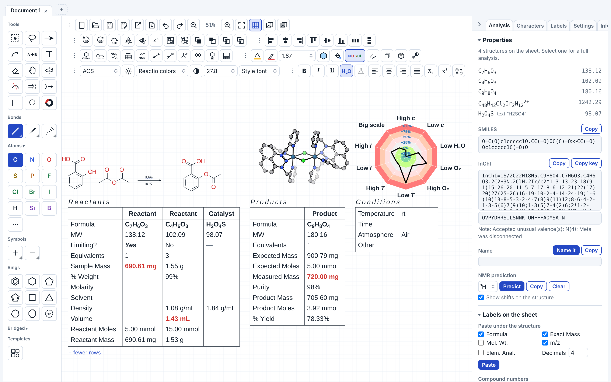

# Reactio Draw

A free chemical structure and reaction editor for organic chemists. Draw with the mouse or the keyboard, keep a
reagent table for every reaction (equivalents, masses, volumes, yield), predict NMR, and move drawings into Word
and PowerPoint or to and from other chemistry editors as CDXML and CDX files. It also helps you check HRMS data.

| [▶ Open in the browser](https://paivel.github.io/reactio-draw/web/) | [⬇ Apps for Windows, Mac and Linux](https://github.com/Paivel/reactio-draw/releases/latest) | [📖 Guide (PDF)](docs/Reactio%20Draw%20-%20Getting%20started.pdf) |
| :---: | :---: | :---: |
| nothing to install | work fully offline | every function and button explained |
| [📝 Word test file](examples/Reactio%20Draw%20-%20marks%20test.docx) | [📄 LaTeX: Lattice](https://github.com/leo1oel/lattice) | [🧩 LaTeX: VS Code extension](https://marketplace.visualstudio.com/items?itemName=paivel.reactio-latex) |
| compound numbers in Word, every kind of mark | a LaTeX editor with a review mode: compound numbers on schemes match the text; double-click a figure to edit it in Reactio Draw ([how](#figures-for-latex-lattice-vs-code-and-overleaf)) | LaTeX in VS Code: compound numbers on schemes match the text; one click opens a figure in Reactio Draw to edit it |
| [🍃 LaTeX: Overleaf](https://github.com/Paivel/reactio-overleaf) | [🧩 ONLYOFFICE plugin](onlyoffice-plugin/ReactioDraw-ONLYOFFICE.plugin) | [📝 ONLYOFFICE test file](examples/Reactio%20Draw%20-%20marks%20test%20(ONLYOFFICE).docx) |
| a Chrome and Edge extension for Overleaf: paste a figure, its files, float and preamble come along; double-click to edit it in Reactio Draw | draw in ONLYOFFICE, double-click to edit, compound numbers as in Word | compound numbers in ONLYOFFICE, drawings and text |

https://github.com/user-attachments/assets/1637fe6d-b6d1-4ec5-9d68-9a41d62ef0c8

## What it does

| | |
| --- | --- |
| **Drawing** | drawing with the mouse as usual, with alignment guides while you drag (edges and centres snap to nearby molecules, arrows and captions); adding groups with hotkeys at the hotspot (the atom or bond under the pointer, marked green; after each key it moves on to the new group, so a chain or a substituted ring is typed key after key, and the arrow keys move it); your own labels and templates; bold or italic single characters (tBu), tBu / iPr prefixes plain, italic or italic superscript in one click; reaction and mechanism arrows, brackets and a charge corner, shapes, sandwich complexes, 3D rotation and 3D shapes, 3D styles (ball and stick, tubes, spheres, after xyzrender), orbitals; Newman, sawhorse and Fischer projections made from a drawing and back, with the configuration kept; Merge structures joins structures drawn on top of each other |
| **Reactions** | a reagent table on the sheet or below it, for the selected reaction or the whole sheet: roles, limiting reagent, equivalents, masses, volumes, concentrations, yield, conditions; reagents written as text (MeMgBr, K2CO3) are counted too; multistep schemes; compound numbers that renumber themselves |
| **Analysis** | formula, molecular weight, exact mass, m/z, isotope pattern, elemental analysis, SMILES, InChI and InChIKey (offline, made when you press Show, for the selection or the whole sheet), CAS number (from the dictionary, or PubChem on request), ¹H/¹³C/¹⁹F/³¹P NMR prediction from measured spectra, pKa estimate; R/S and E/Z labels, IUPAC numbering on the atoms; structure checks as you draw (valence, atoms on top of each other, stray bonds, wedges), each kind can be switched off |
| **Names** | names to structures everywhere: systematic names (OPSIN in JavaScript), common and trade names, CAS numbers and InChIKeys (Octet Draw's tables and a Wikidata dictionary); structures to IUPAC names: Octet Draw's namer everywhere, openclatura in the apps |
| **Files** | its own .reactio documents; CDXML, CDX, MOL and SDF (V2000 and V3000, 3D kept), RXN, CML, SMILES and CXSMILES, ORD; crystal structures from CIF (a test version); XYZ for quantum chemistry (several geometries: pick one in a 3D view, the lowest energy or all); pictures as SVG, PNG, EPS, TIFF, PDF; figures for LaTeX (PDF + .tex with the compound numbers); a scheme as an animation (GIF or video); printing with a preview; pictures on the sheet travel in CDXML and CDX; Word and PowerPoint |
| **Word and PowerPoint** | Ctrl+C → Ctrl+V into Word or PowerPoint on Windows and on Mac. **Double-click a drawing in Word to edit it, on Windows and on Mac alike**; Save in Reactio Draw puts the new drawing back in its place (Edit drawing on the Reactio Draw tab does the same). A document can travel between the two: a drawing put in on Windows is an object, one put in on a Mac a picture, so on the other system double-click does not open it — copy it instead (Ctrl+C in Word, Ctrl+V in Reactio Draw) or use Open in Reactio Draw on the tab, and it comes back complete: structures, reagent table, roles and conditions, nothing lost. The tab (Windows and Mac) also makes plain vector pictures without Reactio Draw data, puts all structures of a document into one CDXML file, and marks pictures that hold Reactio Draw data with hidden, non-printing marks. **Compound numbers in Word**: marks such as [[aldehyde]], [[amine.OMe.letter]] or [[A:catalyst]] in the text and in the drawings become 1, 3a, A… with one click, renumbered after every change, chapters numbered on their own; try it on the [test document](examples/Reactio%20Draw%20-%20marks%20test.docx) |
| **ONLYOFFICE** | a plugin for the Document, Spreadsheet and Presentation editors, desktop and server ([ReactioDraw-ONLYOFFICE.plugin](onlyoffice-plugin/ReactioDraw-ONLYOFFICE.plugin): download it, then Plugins → Plugin Manager → install from the file). Plugins → Reactio Draw draws in a window; OK puts the drawing into the document, and it keeps the whole Reactio Draw document inside. **Double-click a drawing to edit it** in Reactio Draw again, on any computer with the plugin. **Compound numbers**: Reactio Draw ⌄ → Number compounds turns the marks [[aldehyde]], [[amine.OMe]], [[A:catalyst]] of the text and the drawings into 1, 3a, A… with one click, drawings first, chapters numbered on their own, as on the Word tab; Show marks, Remove marks and Final copy too; try it on the [ONLYOFFICE test document](examples/Reactio%20Draw%20-%20marks%20test%20(ONLYOFFICE).docx). Follows ONLYOFFICE's light and dark themes; works offline |
| **LaTeX** | Copy for LaTeX makes a figure whose compound numbers match the text (chemnum), in the drawing's font. Pasted into [Lattice](https://github.com/leo1oel/lattice), VS Code with the extension [Reactio Draw figures for LaTeX](https://marketplace.visualstudio.com/items?itemName=paivel.reactio-latex) (install it from VS Code: Extensions, search for Reactio Draw) or Overleaf with the browser extension [Reactio Draw figures for Overleaf](https://github.com/Paivel/reactio-overleaf), it brings its files and preamble and opens in Reactio Draw for editing ([docs/latex.md](docs/latex.md)) |
| **Charts** | sensitivity screens — the radar diagrams of the condition-based sensitivity assessment of Glorius and co-workers ([Angew. Chem. Int. Ed. 2019, 58, 8572](https://doi.org/10.1002/anie.201901935)), editable on the sheet; product ratio pie and ring charts; Jablonski diagrams, with the transition arrows tied to their levels; reaction energy diagrams from a table of states (typed or from Excel), several paths, editable on the sheet |
| **Working fast** | scrolling in every direction (two fingers, or Shift+wheel sideways) and zoom to the pointer; a hotkey for every button and command, all reassignable, with search by name or by key; your own templates and labels on keys |
| **API and command line** | a local API for scripts (Python, R, curl) in the desktop apps; a command line, `reactio`, that renders, converts and checks files without opening a window ([Command line.txt](Command%20line.txt)); and the same commands for web pages that embed the editor ([EMBEDDING.md](EMBEDDING.md)) |
| **Styles** | ACS, RSC, Nature, Angewandte and more, colour themes (one of them color-blind safe), dark sheets |
| **Light** | the whole editor is one web page of 6.5 MB (about 2.1 MB over the network; 13 MB as a single offline file with the NMR tables and the name reader), with no server and nothing to install; the apps are about 24–32 MB to download. The NMR tables (2.2 MB) come only when you first predict a spectrum, the name reader (3.1 MB) only with the first name it is needed for. |

## Figures for LaTeX: Lattice, VS Code and Overleaf

Schemes go into a LaTeX paper the same way they go into Word: with their compound numbers kept in step with the text.

- **Number compounds once, in the drawing.** Put a mark under a structure, `[[ketone]]`, and write the same key in the
  text, `\rcmpd{ketone}`. LaTeX numbers the compounds (with `chemnum`): the figures' first, in each drawing's order,
  then those only in the text, in the order they are mentioned, so the figure and the text always agree, also after you reorder paragraphs or add a compound. Letters, sub-numbers (2a, 3.1,
  4-1) and series (A, B…; I, II…) are written in the mark ([docs/latex-marks.md](docs/latex-marks.md)).
- **Copy for LaTeX, paste into the paper.** File → Copy to clipboard → Figure for LaTeX (Edit → Copy for LaTeX on the
  Mac). The figure is the drawing as a PDF with its numbers set by LaTeX in the drawing's font; with something
  selected, only that part.
  - In [Lattice](https://github.com/leo1oel/lattice), a LaTeX editor with a review mode, the paste brings the figure's files into `figures/`, adds the
    `\input` and the lines the preamble needs; the compound numbers on the scheme match the text. Double-click the
    figure to edit it in Reactio Draw.
  - In VS Code, for LaTeX there, the extension
    [Reactio Draw figures for LaTeX](https://marketplace.visualstudio.com/items?itemName=paivel.reactio-latex) does the
    same, and the compound numbers on the scheme match the text and are shown in the editor. One click opens the
    figure in Reactio Draw to edit it. Install it from VS Code itself: Extensions (Ctrl+Shift+X), search for Reactio Draw.
  - In [Overleaf](https://www.overleaf.com), the Chrome and Edge extension
    [Reactio Draw figures for Overleaf](https://github.com/Paivel/reactio-overleaf) uploads the figure's drawing, PDF and `.tex` to
    the project's `figures/` folder on paste, inserts the figure and adds what the preamble lacks; double-click the
    figure to open it in Reactio Draw (with its small helper on Mac or Windows).
  - In any other LaTeX editor: copy the `.pdf` and `.tex` written beside the saved drawing into `figures/`
    ([docs/latex.md](docs/latex.md)).
- **Edit the scheme later.** The drawing itself (`.reactio`) travels with the figure, so it can be opened in Reactio
  Draw again; change it and save, and the figure's `.pdf` and `.tex` are made again from it. The numbers stay right,
  as LaTeX gives them.

Works with pdfLaTeX, XeLaTeX, LuaLaTeX and Overleaf.

## Download

| | |
| --- | --- |
| **Browser** | the link above, or `index.html` from this repository: open it in Chrome, Edge, Safari or Firefox |
| **Windows 11** | `ReactioDraw-Windows-x64.zip` (or `-ARM.zip`): unzip, double-click `Install Reactio Draw.cmd` |
| **Mac** | `ReactioDraw-Mac.zip`: double-click `Install Reactio Draw.command` (builds the app on your Mac) |
| **Linux** | `ReactioDraw-Linux-x64.tar.gz` (or `-ARM`): unpack, run `./install.sh`; needs WebKitGTK |
| **AI assistants** | only if you want Claude, Codex or another MCP client (or your scripts) to draw in Reactio Draw: the add-on `…-AI-assistants` for your system, installed after the program ([Install with AI assistants.txt](Install%20with%20AI%20assistants.txt)) |

The apps add naming of structures (openclatura), Word and PowerPoint objects (Windows), the Reactio Draw tab in Word (Windows and Mac) and the `reactio` command line; the add-on adds the local API for scripts and MCP for AI assistants, which read and write files only in the folders you allow in the app (the command line is not limited).

**On your own site:** Reactio Draw can be embedded in any web page (an ELN, a course page, a search form) and driven from its JavaScript: see [EMBEDDING.md](EMBEDDING.md) and the working example in `examples/embed.html`.

**Tested on:** Windows 11 Enterprise 26H2, macOS Sequoia 15.7.4, Ubuntu 24.04.2 LTS. Other recent versions are likely to work but have not been checked; reports are welcome.

## Privacy

Reactio Draw makes no network requests of its own: no accounts, no tracking, no analytics, no fonts or scripts from other sites. Drawings, settings, labels and templates stay in your browser or on your computer. The only downloads are these: the web version is loaded from its site like any web page, and there the NMR tables are downloaded only when you agree, on the first Predict, and kept in the browser (clearing the site's data removes them); a link you click (GitHub, a DOI) opens in your browser; Check for updates (Info) asks GitHub for the newest release, only when you press it, and in the apps a newer version is downloaded only when you then say Update. The apps download nothing else.

NMR prediction is an estimate from nmrshiftdb2 data, not a measured spectrum; the copied text says where the data come from, as the nmrshiftdb2 Database License asks.

## Source

| Folder | What |
| --- | --- |
| `index.html` | the whole program in one file (drawing, analysis, NMR prediction); the apps and the download use it |
| `web/` | the web version GitHub Pages serves, made from `index.html` by `tools/make_web.py`: the NMR tables are a separate file, downloaded on the first Predict |
| `windows-app/` | Windows app: Go + WebView2 window, OLE server for Word and PowerPoint, local API |
| `macapp/` | Mac app: Swift window around the page, installers, naming helper |
| `linux-app/` | Linux app: Go window with GTK and WebKitGTK, local API |
| `data/nmr/` | how the NMR shift tables were built from nmrshiftdb2 |
| `word-addin/` | the Reactio Draw tab for Word (`Reactio Draw.dotm`) and the script and macros it is built from |
| `examples/` | `embed.html`: Reactio Draw embedded in another page (see EMBEDDING.md); `Reactio Draw - marks test.docx`: every kind of compound mark in a Word document, to try Number compounds; `Animation - 3D turns and a reaction.cdxml`: two 3D turns and a reaction, to try File → Export as → Animation (the example of cdxmorph, © 2026 Ryan Shenvi, MIT) |
| `docs/` | the guide `Reactio Draw - Getting started.pdf` (its source, an HTML file with its pictures and build script, is in `docs/guide/`), the hotkey chart `Reactio Draw - Hotkeys.reactio` the README picture `overview-1.5.1.png` and the hotkey chart as a picture |
| `tools/` | scripts that make the web version, the InChI WebAssembly build, the README picture, the hotkey chart and the Windows resources |
| `LICENSES/` | the licences of the third-party parts (see THIRD-PARTY-NOTICES.md) |

### How it was written

Reactio Draw is written from scratch for this project, apart from the open-source parts named in Credits and
`THIRD-PARTY-NOTICES.md`, which are used unchanged under their own licences (OPSIN, OpenChemLib, InChI, and from Octet
Draw only its chemical names: making a name for a structure, and reading names and condensed formulas into structures;
nothing of its drawing, layout, Clean Up or file code). No program was decompiled or disassembled, and no code from commercial chemistry software
is used. File formats are implemented from published descriptions and open-source
projects, each named in Credits and `THIRD-PARTY-NOTICES.md`:

- CDX and CDXML: the CDX property table from ReShiki, which takes it from the published CDX documentation of
  CambridgeSoft (the CDX SDK, archived by the IUPAC FAIRSpec project). Every code in it is also defined in Revvity's
  own open-source ChemDraw format library (BSD-3-Clause), the stoichiometry grid of ChemDraw (objects 0x8022–0x8024,
  properties 0x1200–0x1208) included.
- MOL, SDF and RXN: the CTfile format description.
- Word and PowerPoint objects: Microsoft's published specifications (Office Open XML / ECMA-376, compound files
  [MS-CFB], OLE objects [MS-OLEDS], RTF).
- The Reactio Draw tab in Word (`word-addin/`): a template written by `make_dotm.py` from Microsoft's published
  specifications of the VBA project [MS-OVBA] and of Office's custom tabs [MS-CUSTOMUI]; Word compiles the macros
  (`ReactioDraw.bas`) from their source.

In Word and PowerPoint the drawing is an object of its own type, `ReactioDraw.Drawing.1`; it does not pose as another
program's object.

### Building

- **Web:** nothing to build; `index.html` is the program. For a site, `python3 tools/make_web.py` writes `web/` (the page without the NMR tables, and the tables beside it).
- **Windows** (Go 1.24+): copy `index.html` into `windows-app/`, then in `windows-app/`:
  `GOOS=windows GOARCH=amd64 GOFLAGS=-mod=mod go build -trimpath -ldflags "-H windowsgui" -o ReactioDraw.exe`
  (`GOARCH=arm64 … -o ReactioDraw-ARM.exe`), and the command line: `GOOS=windows GOARCH=amd64 GOFLAGS=-mod=mod go build -trimpath -o reactio.exe ./reactio`.
  Ship `tools/`, `WebView2Loader-*.dll` and `word-addin/Reactio Draw.dotm` (the Word tab) beside the exe.
- **Linux** (Go 1.24+, no C compiler needed): `linux-app/build.sh`. Ship `tools/` (with `windows-app/tools/opsin-2.9.0.jar`)
  and the `reactio` script beside it.
- **Mac:** copy `index.html` to `macapp/index.html`, `windows-app/tools/opsin-2.9.0.jar` to `macapp/opsin.jar`
  and `word-addin/Reactio Draw.dotm` (the Word tab) into `macapp/`, then run `macapp/Install Reactio Draw.command` (needs Apple's Command Line Tools).

All libraries are in the repository (`third_party/` folders), so the builds work offline.

## How to cite

If Reactio Draw helped your work, please cite it: Sakharov, P. *Reactio Draw*, Zenodo,
[doi:10.5281/zenodo.23547490](https://doi.org/10.5281/zenodo.23547490). This DOI always leads to the latest
version; each release also has a DOI of its own (1.3: [10.5281/zenodo.23547491](https://doi.org/10.5281/zenodo.23547491)).
GitHub's **Cite this repository** button (on the right of the repository page) gives the reference in APA and
BibTeX, from `CITATION.cff`.

## Licence

Copyright © 2026 Pavel Sakharov and contributors (see `CONTRIBUTORS.md`).

Reactio Draw is free software under the Mozilla Public License 2.0 (MPL-2.0). See `LICENSE`.

You may use, share and change it, also as part of another program, open or closed. Anyone who
distributes Reactio Draw keeps its files under the MPL-2.0 and makes the source code of any changes
to them available under the same licence; their own files beside it may be under any licence.
Drawings, files and schemes you make with the program are yours; the licence does not cover them.

Versions up to 1.14.1 were released under the GNU Affero General Public License v3.0 or later and
stay under it.

Third-party components and their licences: `THIRD-PARTY-NOTICES.md` and the `LICENSES/` folder.

## Credits

- [Octet Draw](https://github.com/SamChemMan/Octet-Draw) by Sam Ellis (Apache-2.0): its structure → name module with
  the namer of coordination compounds (Alternative name), its reader of condensed formulas, its name tables, and the
  OPSIN build and Wikidata dictionary it made, used unchanged (`names/`, see `names/README.md`).
- [OPSIN](https://github.com/dan2097/opsin) by Daniel Lowe (MIT): reading systematic names.
- [Wikidata](https://www.wikidata.org) (CC0): the dictionary of common and trade names, CAS numbers and InChIKeys.
- Every other part and its licence: `THIRD-PARTY-NOTICES.md`.

Made with the help of Claude (Anthropic).
Questions, ideas and bug reports: [Issues](https://github.com/Paivel/reactio-draw/issues).
News, tips and short videos: the Telegram channel [t.me/reactiodraw](https://t.me/reactiodraw) (comments in English or Russian).
