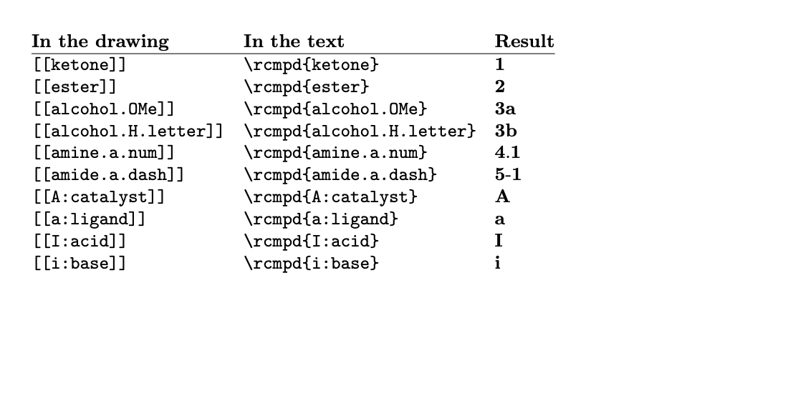

# Compound marks in LaTeX: what to write and what you get

Reactio Draw numbers compounds through marks: `[[key]]` under a structure. For LaTeX, Copy for LaTeX turns each mark
into `\rcmpd{key}`: what is inside `[[ ]]` is exactly what goes inside `\rcmpd{ }`, in the drawing and in the text. LaTeX
numbers the compounds through the `chemnum` package, so the figure and the text always agree, in any order.

Setting up: see [latex.md](latex.md) for how a figure reaches a document. The document needs `\usepackage{chemnum}`,
which a LaTeX editor that pastes figures adds for you.

*Compiled with pdfLaTeX: compounds are numbered in the order they first appear.*

## The marks

Keys are letters, digits, `_` and `-`. The same key is the same compound everywhere.

| In the drawing | In the LaTeX text | Printed |
| --- | --- | --- |
| `[[ketone]]` | `\rcmpd{ketone}` | 1 |
| `[[alcohol.OMe]]` | `\rcmpd{alcohol.OMe}` | 2a |
| `[[alcohol.H.letter]]` | `\rcmpd{alcohol.H.letter}` | 2b |
| `[[amine.a.num]]` | `\rcmpd{amine.a.num}` | 3.1 |
| `[[amide.a.dash]]` | `\rcmpd{amide.a.dash}` | 4-1 |
| `[[first]]–[[last]]` | `\rcmpd{first}--\rcmpd{last}` | 5–6 |
| `Eu ([[eu]], 78%)` | `\rcmpd{eu}` | as written |
| `[[A:catalyst]]` | `\rcmpd{A:catalyst}` | A, B, C… |
| `[[a:ligand]]` | `\rcmpd{a:ligand}` | a, b, c… |
| `[[I:acid]]` | `\rcmpd{I:acid}` | I, II, III… |
| `[[i:base]]` | `\rcmpd{i:base}` | i, ii, iii… |

`\rcmpd` is defined by a short block in the preamble, added once with the first figure that needs it (a LaTeX editor that
pastes figures does this; otherwise take it from the figure's manifest, field `preamble`). The parent of `amine.a.num`
is `\rcmpd{amine}`. One compound should keep one style of sub-number. Plain and numbered compounds mix freely. A series has
its own count, apart from 1, 2, 3, for the whole document. `chemnum`'s own `\cmpd` keeps working beside it; a list goes
through `\cmpd{ketone,alcohol.OMe}`.

## Style, first number and chapters

In a Word file these are the marks `[[#format S{n}]]` and `[[#start 5]]` in the text. In LaTeX the document sets them
once, and those marks are not used:

| What you want | In the preamble (or at that place in the text) | Printed |
| --- | --- | --- |
| Roman main numbers | `\setchemnum{counter-format=Roman}` | I, II |
| Numbered subs | `\setchemnum{sub-counter-format=arabic}` | 61 (no separator) |
| A prefix on one compound | `\cmpd[pre-label-code=S]{c}` | S7 |
| A prefix from here on | `\setchemnum{pre-label-code=S}` | S1, S2 |
| Start from 5 | `\setcounter{cmpdmain}{4}` | 5, 6 |
| Numbers per chapter | `\setchemnum{counter-within=chapter,pre-label-code=\thechapter-}` | 2-1, 2-2a |

## Finding a key while writing (Lattice)

- Rest the pointer on a number in the PDF: its mark appears; a click copies `\rcmpd{…}`.
- Type `\rcmpd{` or `\cmpd{`: the project's keys are listed with their numbers and the figure they are drawn in.
  With a chapter prefix made of a macro, the list shows the number without the chapter; the PDF is right.
